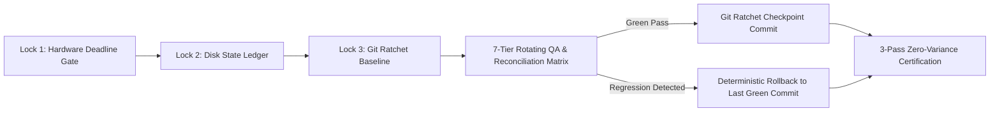

# Sovereign Agent Skills & MCP Governance Framework

**Principal Architect:** Alugunulla Vigneswara Kireeti (Vignesh) — *Level 5 Principal AI Systems Architect*

---

## Executive Overview

Modern autonomous coding and operations agents frequently suffer from three systemic failure modes:
1. **Parametric Hallucination:** Inventing unverified APIs, file paths, or metrics without empirical tool grounding.
2. **Single-Pass Data Drift:** Accepting unverified single-pass scraping or ETL outputs containing silent truncations or unit misallocations.
3. **Unratcheted Autonomous Regression:** Long-running agent loops breaking compilation or UI layout bounds without deterministic rollback gates.

This repository open-sources **four battle-tested, domain-agnostic Agentic Skills (`SKILL.md`)** designed for **Model Context Protocol (MCP)** and autonomous multi-agent swarms:

| Skill Module | Core Architectural Mechanism | Primary Guarantee |
| :--- | :--- | :--- |
| **[`anti-hallucination-nawg`](./skills/anti-hallucination-nawg/SKILL.md)** | **Never Assert Without Grounding (NAWG)** + 4-Step Halt-and-Escalate Gate | Zero synthetic data substitution; mandatory exit-code & DOM proof. |
| **[`multi-pass-reconciliation`](./skills/multi-pass-reconciliation/SKILL.md)** | **3-Pass Independent Extraction & Diff Engine** (`Pass 1` vs `Pass 2` $\rightarrow$ `Pass 3`) | 100.0% zero-variance convergence across scraping, ETL, and ledgers. |
| **[`git-ratcheted-autonomous-loop`](./skills/git-ratcheted-autonomous-loop/SKILL.md)** | **The 4 Ironclad Locks** (Hardware Deadline, Disk Ledger, Git Ratchet, Watchdog) | Unstoppable multi-hour self-healing QA across 7 rotating architectural tiers. |
| **[`cdp-web-telemetry-suite`](./skills/cdp-web-telemetry-suite/SKILL.md)** | **Batched Chrome DevTools Protocol (CDP)** single-pass DOM & Performance probes | Sub-second WCAG 2.2 AA/AAA contrast, CWV, memory heap, and boundary fuzzing. |

---

## Architectural Flow: The 4 Ironclad Locks & 3-Pass Reconciliation

## License
Apache-2.0
