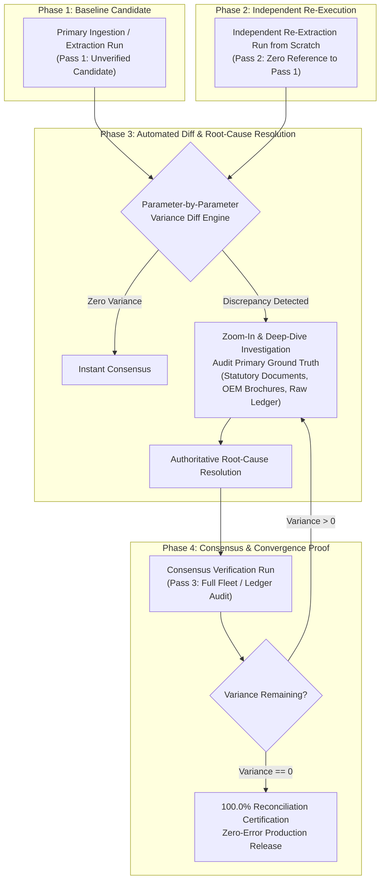

# Reconciliation: Universal Multi-Pass Verification & Consensus Skill

## 1. Core Philosophy: Why Multi-Pass Reconciliation Exists

Single-pass execution produces an unverified candidate, never ground truth. 
Whether scraping web portals, ingesting telemetry, migrating databases, or parsing financial ledgers, single-pass processes are vulnerable to:
* **Silent Truncation & Parsing Bugs**: Scrapers or regexes cutting strings prematurely (e.g., truncating `50` to `5`).
* **Fallback Contamination**: Hardcoded defaults silently injected when a field fails to parse.
* **Semantic & Unit Misallocation**: Assigning electrical battery units (kWh) to liquid fuel tanks (Litres), or gross vehicle weight to kerb weight.
* **Source Conflation**: Applying sub-tier or accessory specs to primary products.

**The Golden Rule of Reconciliation**:
> *You do not test data by reading what you just wrote. You test data by re-executing the entire extraction process from scratch independently, diffing Attempt 1 against Attempt 2, isolating every point of variance, resolving the root cause against primary ground truth, and proving zero remaining discrepancies in Attempt 3.*

---

## 2. The 4-Phase Universal Reconciliation Framework

---

## 3. Step-by-Step Operating Protocol

### Step 1: Pass 1 — Establish Baseline Candidate
- Execute the primary data extraction, scraping, calculation, or migration pipeline.
- Capture all target dimensions, metrics, and attributes into an immutable candidate dataset `Candidate_A`.
- Explicitly flag any fallbacks or missing fields without guessing.

### Step 2: Pass 2 — Independent Full Re-Execution
- **Strict Isolation**: Re-run the entire extraction, calculation, or collection process independently to generate `Candidate_B`.
- Do **not** allow `Candidate_B` to read, inherit, or cache values from `Candidate_A`.
- Use independent parsing pathways, fresh network requests, direct PDF/source document reading, or direct SQL extraction.

### Step 3: Automated Diff & Discrepancy Isolation
- Execute a strict, field-by-field, row-by-row comparison between `Candidate_A` and `Candidate_B`.
- Flag all discrepancies into five standard variance classes:
  1. **Truncation / Precision Drift**: Numerical shortening (e.g. 5 vs 50, 1498 vs 1500).
  2. **Unit / Domain Misallocation**: Dimensions or capacities placed in the wrong parameter slot (e.g. battery kWh assigned as fuel litres).
  3. **Measurement Standard Conflict**: Different measurement methodologies (e.g. unladen vs laden ground clearance, parcel-shelf boot volume vs maximum flat-floor cargo).
  4. **Fallback Contamination**: One pass used a fallback default while the other extracted real data.
  5. **Drivetrain / Logical Anomaly**: Mechanically or physically impossible outputs (e.g. a mid-engine supercar labeled as FWD).

### Step 4: Root-Cause Investigation & Resolution
- For every flagged variance:
  - Isolate the conflicting records.
  - Inspect the **Primary Authoritative Source** (official homologation sheet, manufacturer legal brochure, audited statutory filing, physical bank ledger).
  - Determine which candidate was wrong and identify the bug in that candidate's extraction logic.
  - Apply the correction to the unified authoritative model.

### Step 5: Pass 3 — Full Consensus & Convergence Proof
- Execute Pass 3 across the entire dataset.
- Re-calculate the full comparison matrix across 100% of records.
- Convergence Condition: **Remaining Discrepancies == 0**.
- If any discrepancy remains, the process loops back to Step 4. Never ship with unresolved variance.

---

## 4. Standard Reconciliation Scorecard Format

Every reconciliation task must conclude with an institutional-grade tabular scorecard:

| Reconciliation Stage | Action Executed | Scope / Checkpoints Audited | Discrepancies Flagged | Resolution Action Taken |
| :--- | :--- | :---: | :---: | :--- |
| **Pass 1 (Attempt 1)** | Primary data ingestion / extraction | $N$ checkpoints | Baseline established | Raw candidate recorded |
| **Pass 2 (Attempt 2)** | Independent re-extraction from source | $N$ checkpoints | $K$ conflicts flagged | Flagged for deep-dive audit |
| **Deep-Dive Resolution** | Root-cause analysis vs primary source | $K$ conflicts | $K$ resolved | Authoritative ground truth locked |
| **Pass 3 (Attempt 3)** | Full consensus verification run | $N$ checkpoints | **0 remaining conflicts** | **100.0% Convergence Achieved** |

---

## 5. Domain Adaptability: Where to Apply This Skill

This framework applies identically across any technical domain:

1. **Web Scraping & E-Commerce / Automotive Portals**:
   - Pass 1: Scraped aggregator listings.
   - Pass 2: Scraped official brand portals / OEM PDF spec sheets.
   - Diff: Catches rounded engine cc, fake boot volumes, European laden specs applied to Indian cars.
2. **Financial & Accounting Ledgers**:
   - Pass 1: Bank feed statement transactions.
   - Pass 2: Internal Enterprise Resource Planning (ERP) / Payment Gateway transactions.
   - Diff: Catches timing differences, merchant fees, duplicate charges, truncated wire references.
3. **Database Migrations & Data Warehousing (ETL/ELT)**:
   - Pass 1: Source OLTP database record extraction.
   - Pass 2: Target Data Warehouse / BigQuery ingestion checksum.
   - Diff: Catches timezone truncation, type-casting issues, dropped foreign keys.
4. **Multi-Agent & Multi-LLM Output Consensus**:
   - Pass 1: Agent A independent solution / code output.
   - Pass 2: Agent B independent solution / code output.
   - Diff: Surfaces subtle edge-case assumptions, hallucinations, or unhandled exceptions before merging to production.
